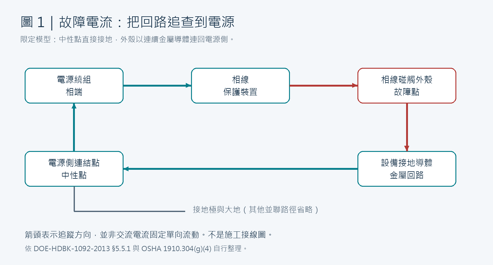
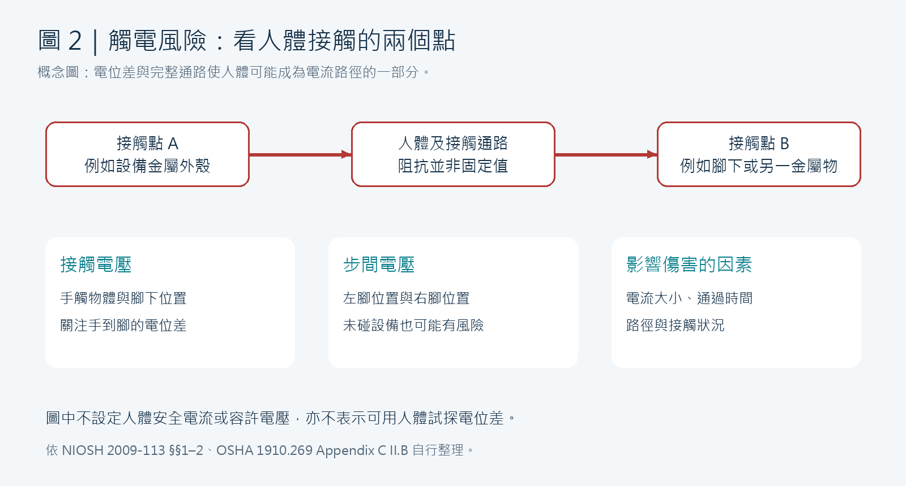
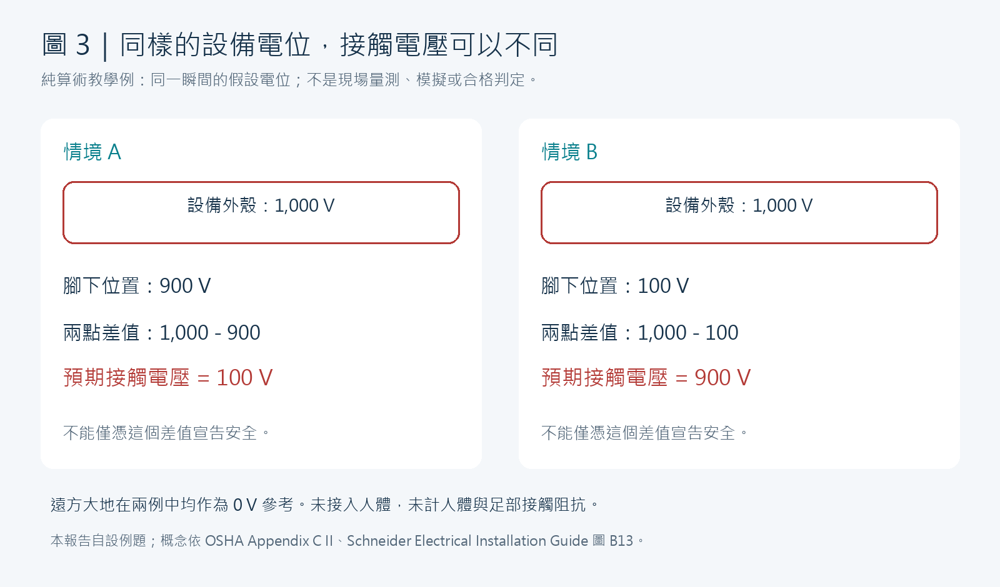

# 火力發電廠接地原理

## 接地如何作用、人體為何觸電、接地網如何影響現場安全

**版本 1.0｜2026-10-31｜公開資料技術解說版**

本版完成三項主題的基礎解說。讀者先追查電流回路，再辨識人體接觸兩點的電位差，最後理解接地網與故障切除如何共同影響風險。

本報告引用已讀取的政府教材、研究報告與技術文件。IEEE／IEC 標準全文仍未取得，因此不宣稱已符合其全部要求。文中的火力電廠情境與算術例題均為教學設定，並非現場紀錄；本文不提供施工尺寸或驗收門檻。

來源編號、原文頁碼與適用限制見 [查證紀錄](GROUNDING_EVIDENCE.md)。以下 PDF 頁碼如未特別註明，均指文件印刷頁碼。

---

## 第一部分｜接地原理怎麼理解？

### 1.1 先分清楚接的是什麼

「電源系統的某一點接地」與「設備金屬外殼接地」回答不同問題。前者處理系統對地關係；後者處理外殼意外帶電時的保護。OSHA 的入門教材也分別介紹系統接地與設備接地。[S03](https://www.osha.gov/etools/construction/electrical-incidents/grounding)

| 本報告使用的概念 | 閱讀圖說時要問的問題 |
| --- | --- |
| 系統接地 | 電源哪個點接地？連接中是否有阻抗？ |
| 設備接地 | 正常不應帶電的外殼，故障時如何形成保護通路？ |
| 等電位連結 | 人可能同時接觸的導電物體，如何減小彼此電位差？ |
| 接地極與接地網 | 與土壤接觸的導體如何分布？如何影響周圍電位？ |

這是閱讀框架，不是全廠接地系統分類表。對火力電廠而言，先用「變壓器中性點」與「廠用馬達外殼」兩個問題建立觀念即可，暫不展開設備選型。

### 1.2 電流必須沿回路流動

以中性點直接接地、外殼有金屬保護回路的系統為例，相線碰觸外殼後，電流可經設備接地導體與電源側連結點返回電源。DOE 手冊 §5.5.1 直接描述這條回路。[S05，p.33](https://www.energy.gov/sites/default/files/2026-04/DOE-HDBK-1092-2013.pdf)

**圖 1 的限制：**箭頭只供追蹤回路，不表示交流電流固定單向流動。它省略正常負載與並聯回路；不能套用到所有中性點接地方式。大地也不是圖中的「電流終點」。

保護通路還需要連續、有足夠載流能力及適當阻抗，才能配合保護裝置。接上導線本身，並不能證明故障時一定按預期跳脫。[S05，§§5.3–5.4，pp.30–31](https://www.energy.gov/sites/default/files/2026-04/DOE-HDBK-1092-2013.pdf)

「電流只走電阻最小的一條路」也不正確。以兩個有限電阻並聯的基本電路為例，兩支路承受相同電壓，各有電流；較低電阻支路的電流較大，不代表另一支路沒有電流。這是本報告依基本並聯電路關係所作的解說。[S07，Module 8，pp.15–16](https://www.energy.gov/sites/default/files/2026-04/DOE-HDBK-1011-92_VOL3.pdf)

### 1.3 電阻與阻抗有什麼不同？

電阻 R 與阻抗 Z 都以歐姆表示。交流阻抗還包含電抗及相位關係；在正弦穩態的等效串聯模型中，阻抗大小可寫為：

**|Z| = √(R² + X²)**

其中 X 是淨電抗，單位同為 Ω。這不是把兩個數值直接相加。DOE 基礎教材同時說明交流電壓、電流與阻抗的關係。[S07，Module 8，pp.9–11](https://www.energy.gov/sites/default/files/2026-04/DOE-HDBK-1011-92_VOL3.pdf)

本報告據此提醒：看到「接地電阻」測值時，要先確認量測對象與條件；不能直接把它當作所有頻率、暫態及回流路徑的完整特性。本章聚焦電力頻率的故障原理，不進行雷擊計算。

### 1.4 接地不等於永遠是零伏

故障電流通過具有阻抗的接地通路時，接地物體仍可能相對遠方大地升高電位。周圍地面也可能有不同電位；這就是理解地電位升高與地表電位梯度的起點。[S01，I、II.A](https://www.osha.gov/laws-regs/regulations/standardnumber/1910/1910.269AppC)

在僅考慮電阻的簡化模型中，可用以下關係理解地電位升高：

**U_G ≈ I_G × R_G**

| 符號 | 此簡化模型的意思 |
| --- | --- |
| U_G | 接地網相對遠方大地的電位升高，V |
| I_G | 由所考慮接地網流入土壤的電流，A |
| R_G | 該接地網對遠方大地的等效電阻，Ω |

這是電流乘電阻的教學近似，不是完整地網分析。有其他回流路徑時，總故障電流不必等於流入土壤的電流；公開 IEEE PCIC 論文也討論架空屏蔽線等路徑造成的分流。本稿只採用這個定性觀念，不採用該文的設計限值或分流計算法。[S09，圖 B12 的簡化關係](https://www.electrical-installation.org/enwiki/General_principle_of_protection_against_electrical_shocks_in_electrical_installations)；[S10，§V.A，p.3](https://ieeepcic.com/2022conference/wp-content/uploads/sites/7/2022/09/2022-PCIC-0559.pdf)

---

## 第二部分｜人為什麼會有觸電風險？

### 2.1 人體可能成為電路的一部分

觸電的核心是人體連接了不同電位的接觸點，並形成可流通電流的通路。這可能是手接觸帶電導體、另一部位接地，也可能是同時接觸兩個不同電位的導體。[S04，§1，pp.2–5](https://www.cdc.gov/niosh/docs/2009-113/pdfs/2009-113.pdf)

從接觸對象來看，可以區分接觸正常帶電部分，以及接觸因絕緣故障而帶電的外殼。前者涉及基本防護，後者涉及故障防護；設備接地不能代替對正常帶電部分的隔離或絕緣。[S09，Direct contact、Indirect contact、Direct-contact protection](https://www.electrical-installation.org/enwiki/General_principle_of_protection_against_electrical_shocks_in_electrical_installations)

### 2.2 傷害為何不能只看電壓？

NIOSH 教材說明，傷害與人體電流大小、通過時間和路徑有關；潮濕、皮膚破損、接觸面積及壓力會影響通路阻抗。跨越胸部的電流尤其需要重視。電流還可能造成肌肉失控、無法鬆手、灼傷或跌落等後果。[S04，§2，pp.6–11](https://www.cdc.gov/niosh/docs/2009-113/pdfs/2009-113.pdf)

因此，本稿不指定一個對所有人、所有環境都安全的電壓或電流，也不把人體當作固定電阻。讀者應依序追問：**接觸了哪兩點、通路有何條件、電流可能持續多久。**

### 2.3 接觸電壓與步間電壓

| 名稱 | 關注哪兩點？ | 概念情境 |
| --- | --- | --- |
| 接觸電壓 | 所觸物體與腳下位置 | 手碰外殼，腳站在旁邊地面 |
| 步間電壓 | 兩腳所在位置 | 人未碰設備，但站在有地表電位梯度的區域 |

兩者都描述電位差。未碰設備不代表沒有觸電通路。[S01，II.B](https://www.osha.gov/laws-regs/regulations/standardnumber/1910/1910.269AppC)

以下自設例題固定設備電位為 1,000 V，只改變腳下位置的假設電位，以比較差值。所有數字都不是實測值或安全限值。

圖 3 顯示：同樣的設備對遠方大地電位，可能對應不同接觸電壓。圖中比較的是人體尚未接入時的兩點電位差；實際人體電流仍須考慮人體、接觸與周圍系統的等效阻抗。這個例子不能用來宣告情境 A 合格。

### 2.4 為什麼保護動作時間重要？

接地與保護裝置必須一起理解。保護裝置能否偵測並切除故障，影響危險存在多久；不能把「有斷路器」等同於所有接地故障都會立刻消失。DOE 手冊另外討論不接地及高阻抗接地系統，說明其保護邏輯不能直接套用直接接地系統的例圖。[S05，§§5.5.1–5.5.3，pp.33–35](https://www.energy.gov/sites/default/files/2026-04/DOE-HDBK-1092-2013.pdf)

---

## 第三部分｜接地網如何影響現場安全？

### 3.1 接地網要控制的是空間中的電位分布

接地網是分布於區域內、互相連接並埋設於土中的導體系統。其配置會影響地表電位分布；適當的網格與電極配置可減小局部電位差。EPRI 的開關場報告以電位分布圖解釋這個作用。[S06，pp.2-36、2-51，圖 2-18](https://restservice.epri.com/publicdownload/000000003002013162/0/Product)

這裡的目標不是宣稱每一點完全等電位，而是辨識人可能跨接的位置，評估當時的電位差。Schneider 的技術指南也以電位控制電極說明減小接觸與步間電壓的原理。[S09，圖 B13](https://www.electrical-installation.org/enwiki/General_principle_of_protection_against_electrical_shocks_in_electrical_installations)

### 3.2 連結、網格與表層材料的角色不同

| 要素 | 原理作用 | 不能僅憑外觀判定的事情 |
| --- | --- | --- |
| 設備與導電物體的連結 | 減小物體之間的電位差、建立保護回路 | 是否連續、有足夠容量 |
| 接地網幾何配置 | 影響區域內地表電位差 | 操作點與邊界是否滿足安全條件 |
| 地表材料 | 影響足部接觸條件及地表電氣行為 | 石材、厚度、潮濕或污染後的性質 |

表層碎石的作用不能簡化成「讓地網電阻更低」。較高電阻率的表層可增加足部通路阻抗，但效果取決於材料與現場條件。EPRI 指出表層材料與厚度會影響安全分析，材料改變時需要重新評估；本稿不提供通用碎石厚度。[S06，pp.2-38–2-39、2-51–2-52](https://restservice.epri.com/publicdownload/000000003002013162/0/Product)

等電位區的效果也有範圍。人若跨越其邊界，或接觸區外的不同電位物體，不能延用區內的保護假設。[S01，III.C.1](https://www.osha.gov/laws-regs/regulations/standardnumber/1910/1910.269AppC)

### 3.3 場外也可能受到影響

導電連接可能把一處的電位帶到另一處，形成轉移電位問題。分析範圍因此不能只停在地網平面圖的外框，還要追查連到區域外的導電路徑。[S06，§2.2.6.3，pp.2-58–2-59](https://restservice.epri.com/publicdownload/000000003002013162/0/Product)

本稿提出的閱讀問題是：某金屬物連到哪一區？人站在哪裡？另一個接觸點是否屬於相同電位區？這些問題不等於要求一律連接或一律隔離，實際方案需依系統分析決定。

### 3.4 為什麼不能以一個 Ω 數字代表安全？

USBR 的水力設施試運轉指南，將地網阻抗、設計核對及故障造成的區域電位變化列為地網試驗關注事項。[S08，§6.1.48.1，p.138](https://www.usbr.gov/power/data/fist/FIST_4-7_%288-2023%29.pdf)

結合本章的電位差與人體通路觀念，本報告的綜合判斷是：**接地電阻是資料之一，不能單獨取代現場人身安全評估。** 還需要故障情境、保護時間、電位分布與人員接觸條件。本稿引用 USBR 的分析目的，不採用其水力設施試驗程序作為火力電廠驗收要求。

### 3.5 用火力電廠情境練習判讀

以下是本報告自行設定的閱讀練習，沒有對任何實際電廠作合格判定。

| 情境 | 第一個應追問的問題 | 需要補足的資料 |
| --- | --- | --- |
| 廠用馬達相線碰殼 | 外殼故障電流如何回到電源？ | 單線圖、接地連結圖、保護設定 |
| 人在開關設備旁操作 | 手與腳所在位置是否有電位差？ | 故障分析、操作位置、地表電位與表層條件 |
| 人站在地網邊緣 | 兩腳或手腳是否跨越不同電位區？ | 地網範圍、邊界與區外分析 |
| 金屬管線跨出場區 | 是否存在轉移電位路徑？ | 管線連續性、接地／隔離關係及區外接觸點 |
| 新增機組或改動保護設定 | 原接地分析的假設是否仍成立？ | 新舊故障資料、保護時間與原分析條件 |

---

## 本章的使用方式與後續界線

現在可以用本章建立三項理解：故障電流如何形成回路、人體如何跨接電位差，以及地網如何改變現場的電位分布。閱讀施工圖或測試報告時，可以據此提出具體問題。

本版不包含接地網尺寸計算、人體容許值選定、施工安裝或驗收判定，也未涵蓋防雷暫態、儀表接地與 GIS 特殊問題。這些屬後續工程章節，需確認標準全文、所在地規範及電廠資料後再進行。**這不影響本次三部分原理解說的完成，但限制了其作為工程設計文件的用途。**

## 來源導覽

| 編號 | 文件 | 本章用途 |
| --- | --- | --- |
| S01 | OSHA 1910.269 Appendix C | 接地電位、步間／接觸電壓及等電位區 |
| S02 | OSHA 1910.304 | 圖 1 的連接關係；與前版銜接 |
| S03 | OSHA Construction eTool: Grounding | 系統與設備接地的入門區分 |
| S04 | NIOSH 2009-113 | 人體觸電條件及傷害因素 |
| S05 | DOE-HDBK-1092-2013 | 故障回路與設備接地、保護邏輯 |
| S06 | EPRI 3002013162，2018 | 網格、表層材料與轉移電位 |
| S07 | DOE-HDBK-1011/3-92，1992 | 電阻、電抗與阻抗的電路基礎 |
| S08 | USBR FIST 4-7，2023 | 地網評估不能只有單一電阻值 |
| S09 | Schneider Electric Electrical Installation Guide | 接觸類型、簡化模型與電位控制 |
| S10 | Amnit Dhindsa，IEEE PCIC 公開論文，2022 | 故障電流分流的定性補充；非 IEEE 標準 |

詳細書目、查核位置、保留與排除事項均見 [查證紀錄](GROUNDING_EVIDENCE.md)。
