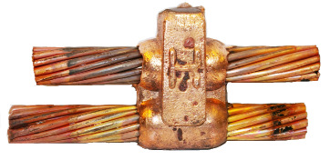
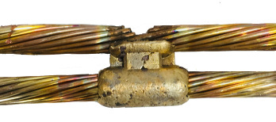

# 接地系統安裝與施工示範

版本：0.1｜2026-11-01｜第一輪施工研究與接頭照片示範

本輪依使用者指示，先進行安裝與施工示範。按施工工作分組，不等待全廠系統分類完成。現階段以公開施工文件及製造商原始圖像建立示範卡，地區、業主與電廠圖說尚待確定；以下不是可直接簽發的現場施工程序。

## 1. 本階段架構與進度

| 單元 | 要回答的問題 | 本輪成果 | 下一輪工作 |
| --- | --- | --- | --- |
| A 地下接地導體與接地極 | 如何配置、埋設及留存隱蔽工程證據？ | 建立作業與紀錄框架 | 補電廠／變電站施工圖與埋設照片 |
| B 放熱熔接接頭 | 如何準備、施工及辨識成品狀況？ | 完成第一張示範卡與原廠照片對照 | 補其他接頭形狀與產品程序 |
| C 壓接與螺栓連接 | 如何確認工具、端子與接觸面？ | 建立資料需求 | 補產品型號、壓接圖與扭矩原文 |
| D 設備端接地與跨接 | 如何連到外殼、接地排及活動接合部？ | 建立現場示範題目 | 補設備端子及跨接施工照片 |

每個單元最後均應包含：適用條件、施工順序、來源定位、照片、可觀察重點、必要紀錄，以及照片不能證明的事項。獨立的「缺失判讀與驗收」章節仍留後續；此處的觀察重點用於解讀施工示範。

## 2. 採用哪些施工依據？

**I01：NASA UFGS 26 05 26.00 40。** 這是供專案編製的施工規範範本，含材料、安裝與品質文件要求；其方括號與空格須由專案選定。§2.1.3 分別列出放熱熔接、不可逆壓接與機械連接，不能因某一接頭示範就推論全部地下接頭只能使用同一種方法。[官方 PDF](https://www.wbdg.org/FFC/NASA/UFGS/UFGS%2026%2005%2026.00%2040.pdf)

**I02：Harger 安裝與檢查指南。** 用於 Ultraweld 產品的準備、成品與照片說明。產品操作細節與外觀條件限於該系統，不能直接當作其他品牌的通用驗收條款。[原廠 PDF](https://www.harger.com/sites/default/files/resources/Inspectors%20Guide%202017_11-26-18_0.pdf)

## 3. 先建立施工工作順序

以下為本報告擬定的工作編排，須與實際核定圖說和施工計畫對照後才能現場使用。

1. **核對圖說與材料**：確認接地路徑、接頭編號、材料及預定連接方式。
2. **確認工作條件**：查明地下設施、鄰近帶電設備及與既有地網的介面；依電廠工作許可安排作業。
3. **定位及施工**：按核定座標、標高與產品程序完成導體、電極及接頭。
4. **隱蔽前檢查**：拍攝全景與細部，記錄接頭、埋設位置及實際尺寸。
5. **測試與收尾**：依專案要求測試、處理不符合項，再完成回填及竣工紀錄。

其中第 4 步建議設為本案待討論的見證／停留點，這是我們的品質規劃建議，不冒稱為來源的強制條文。

## 4. 示範卡 B-01：銅導體放熱熔接

### 4.1 適用前提

本卡說明接地導體接頭的工序與成品觀察，不適用鋼筋結構續接或軌道接頭。先確認核定連接方法、導體材質與尺寸、接頭形狀及產品型號；模具、材料與藥劑須按原廠匹配，不以外觀相似代替相容性核對。[I01，§2.1.3.1，p.9](https://www.wbdg.org/FFC/NASA/UFGS/UFGS%2026%2005%2026.00%2040.pdf)

放熱熔接涉及高溫反應，實際操作須使用所選產品的完整指示、安全資料、作業許可及受訓人員；本卡不提供點火配方或通用冷卻時間。

### 4.2 工序與留證

| 工序 | 示範要點 | 建議留存的證據 |
| --- | --- | --- |
| 產品配對 | 核對模具標籤、導體與焊材 | 標籤、料號、導體規格 |
| 清潔與乾燥 | 按原廠指示處理導體與模具 | 施工前接觸面、作業紀錄 |
| 放置與閉模 | 按接頭圖放置導體，確認模具狀況 | 導體位置及閉模前照片 |
| 原廠程序施工 | 依所選 UltraShot 或 NUWTube 程序操作 | 操作者、批次、接頭編號 |
| 成品觀察 | 清理後觀察焊體、包覆與污染跡象 | 同一接頭兩側及必要細部照片 |

工序依 I02 印刷 pp.3–8 整理；表中的證據欄為本報告提出的紀錄方式。兩種產品操作順序不同，不能拼接成一套程序。

### 4.3 原廠成品照片對照

**原廠標為良好接頭的範例：**

來源：Harger，I02 印刷 p.9「Good Welds」（PDF 第 6 頁左下第一張）。原圖直接抽取，未重繪；保留原始解析度。

**原廠標為填充不足的範例：**

來源：Harger，I02 印刷 p.12「Bad Welds」（PDF 第 7 頁右欄中圖）。原廠指出焊體低於導體頂部且包覆未填滿；可能原因包括焊材不匹配或漏料，照片本身不能確定原因。

閱讀時先比對焊體與導體的相對位置、包覆完整性及明顯污染。不要把顏色或單一表面小孔直接當作通用合格判準。[I02，pp.9–13](https://www.harger.com/sites/default/files/resources/Inspectors%20Guide%202017_11-26-18_0.pdf)

上述是原廠示範接頭照片，並非已核實的火力電廠施工紀錄。外觀可支持初步觀察，不能取代產品適配、載流能力、接頭測試或整體地網安全確認。

## 5. 其他三個單元先準備什麼？

### A 地下導體與接地極

本案先建立「圖說要求／現場實測／照片編號」三欄對照；需要的參數包括材料、截面、埋深、接地極位置與長度、地下障礙及接頭位置。暫不指定通用埋深或棒長。I01 §3.1.1、§3.1.3 的內容須依其環形接地與建築情境解讀，不直接外推為全廠地網要求。

照片需求：定位全景、埋深尺規與基準、交會接頭、設備引出點、回填前整體走向。這是待蒐集清單，目前尚無已核實電廠照片。

### C 壓接與螺栓連接

先取得端子／連接器、工具及模具的配套資料，再編寫壓接次序或緊固方式。I01 §2.1.3.2–3 強調依製造商指示使用工具及連接器；本版不填入通用扭矩、壓接次數或模具號。

照片需求：端子型號、導體插入狀態、壓接印記、接觸面、螺栓組合及完成狀態。扭矩是否確實施加，需要紀錄支持。

### D 設備接地與跨接

優先選馬達外殼、盤體接地排及活動／伸縮接合部作為後續示範。I01 §3.1.2、§3.1.6 涵蓋跨接與設備連結；具體路徑仍須依設備端子及圖說確認。

照片需求：設備與端子全景、連接面細部、導體保護及跨接活動餘量。不可因某處沒有跨接就一律判錯，還需確認是否有刻意設置的電氣隔離。

## 6. 本輪交付界線

已完成施工單元架構、工作順序、第一張放熱熔接示範卡及兩張原廠接頭照片。A、C、D 尚待補齊已核對的施工圖像與產品程序；專案的實際尺寸、測試門檻及現場照片也仍待取得。

詳見 [施工來源與圖像紀錄](INSTALLATION_EVIDENCE.md)。接地原理完整正文仍可由 [原理章節](GROUNDING_PRINCIPLES.md) 閱讀。
